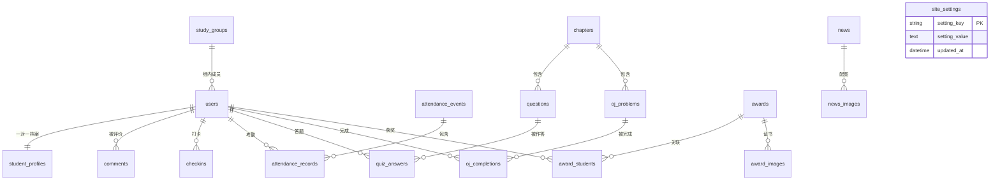

# 数据库设计说明书

| 项目 | 内容 |
|---|---|
| 数据库 | MySQL 8.0+（本项目实测 **MySQL Server 26.7**，Windows 服务名 `MySQL267`） |
| 字符集 | utf8mb4 / utf8mb4_unicode_ci |
| 表数量 | ⭐ **20 张**（P1 使用 **15** 张 —— 含功能已取消但保留的 `comments` 与站点配置 `site_settings`；P2 预留 **5** 张）<br>2026-10-04 新增第 19 张 `password_reset_requests`（忘记密码申请，T-012B）；第 20 张 `site_settings`（站点设置，T-042，脚本 [sql/04](../sql/04-add-site-settings.sql)） |
| 建表脚本 | [01-schema.sql](../sql/01-schema.sql)（**19 张**，v1.1 起已含 `password_reset_requests`） |
| 增量脚本 | [03-add-password-reset-requests.sql](../sql/03-add-password-reset-requests.sql)（第 19 张）、[04](../sql/04-add-site-settings.sql)（第 20 张）、[05](../sql/05-add-checkins.sql)（补 `checkins`）、[06](../sql/06-add-must-change-password.sql)（🆕 2026-10-07：`users` 加 `must_change_password` 列，**不改表数**）—— 四个都是**幂等**脚本 |
| 初始数据 | [02-seed.sql](../sql/02-seed.sql) |
| 版本 | v1.5 ｜ 2026-10-07 |

---

## 1. 设计原则

| # | 原则 | 说明 |
|---|---|---|
| 1 | **用户一张表，角色靠字段区分** | 不建 teacher/president/student 多张表，避免登录时到处查 |
| 2 | **档案与账号分离** | users 管身份和权限，student_profiles 管学员特有信息 |
| 3 | **打卡表用通用结构** | 日期 + 指标类型 + 数值 + 来源。换指标不用改表 |
| 4 | **公开意愿存在关联表上** | 团队奖里每个人独立决定是否公开 |
| 5 | **操作留痕** | 代打卡、代录入都记录操作人 |
| 6 | **核心父子关系全部建外键** | 如 questions→chapters、award_students→awards/users、attendance_records→attendance_events/users、**password_reset_requests→users** 等；而「录入人 / 发布人 / 操作人 / 上传人 / **审核人**」这类**弱引用**（created_by、author_id、operator_id、uploader_id、confirmed_by、**reviewed_by**）**故意不建外键**，避免删用户时连带影响历史记录 |
| 7 | **枚举用字符串不用数字** | 直接看数据库就知道是啥，不用查字典 |
| 8 | **P2 的表先建空表** | 避免二期做数据库迁移 |

---

## 2. 表清单总览

| 分组 | 表名 | 说明 | 阶段 |
|---|---|---|---|
| **用户与组织** | study_groups | 学习小组 | P1 |
| | users | 用户（全部角色） | P1 |
| | student_profiles | 学员档案 | P1 |
| | comments | 学员评语 | ⏸️ **表保留但功能已取消**（2026-10-02） |
| **打卡核心** | checkins | 打卡 / 签到记录 ⭐ | P1 |
| **考勤** | attendance_events | 考勤活动 | P1 |
| | attendance_records | 考勤记录（代打留痕） | P1 |
| **获奖** | awards | 获奖记录 | P1 |
| | award_students | 获奖-学员关联（含公开意愿） | P1 |
| | award_images | 证书照片 | P1 |
| **新闻** | news | 新闻公告 | P1 |
| | news_images | 新闻配图 | P1 |
| **文件** | upload_files | 上传文件登记 | P1 |
| **账号安全**（🆕 2026-10-04） | password_reset_requests | 忘记密码申请（申请 + 社长审核，**非重置**） | P1 |
| **站点配置**（🆕 T-042） | site_settings | 站点级键值配置（首页背景图等） | P1 |
| **题库（预留）** | chapters | 章节 | P2 |
| | questions | 选择题 | P2 |
| | quiz_answers | 答题记录 | P2 |
| | oj_problems | 外链编程题 | P2 |
| | oj_completions | 外链题完成标记 | P2 |

> ✅ **合计 20 张**：P1 **15** 张（上表 P1 行 + 已取消但保留的 `comments`）+ P2 预留 **5** 张。
> 📌 **实测现状（2026-10-04）**：库中 **20 张表**；`sql/03`、`sql/04` **两个增量脚本均已执行**。
> 题库那 5 张**仍是空表**（`chapters` 有 2 行示例数据，但无 Java 实体，二期才实现）。

> 🔄 **2026-10-04 · 两个新需求最后都"建了表"**（本条曾写成"只有一个建表"，已按实际实现更正）
>
> 两个新需求都需要"存东西"，当时的 18 张表里都没有：
>
> | 需求 | 需要存什么 | 最终结论 | 说明 |
> |---|---|---|---|
> | **T-012B 忘记密码** | 改密申请（申请人 / 新密码哈希 / 审核状态 / 审核人 / 时间） | ✅ **新增 `password_reset_requests` 表**（即第 19 张） | 2026-10-04 项目负责人选定 **A 方案**。变更脚本：[`sql/03-add-password-reset-requests.sql`](../sql/03-add-password-reset-requests.sql)（幂等）—— **已执行** |
> | **T-042 站点设置 · 首页背景图** | "当前首页用的是哪张背景图" | 🔄 **实际改为新增 `site_settings` 表**（第 20 张） | ⚠️ 2026-10-04 曾决定「**暂用白色、不建表**（C 方案：纯 CSS）」，但**该决定后来被实际实现推翻**：代码里建了 `site_settings` 键值表，脚本 [`sql/04-add-site-settings.sql`](../sql/04-add-site-settings.sql)（幂等）—— **已执行**。功能本体 ✅ **已完成**（2026-10-04 接线：背景图铺满「整个首页」+ 白色 40% 遮罩） |
>
> ⚠️ 以后若还要**改数据库结构**（加表 / 加字段 / 改类型），**仍须先经项目负责人批准**（`AGENTS.md` §7）。

---

## 3. ER 图（实体关系）



> 📌 `site_settings`（第 20 张，T-042）是**独立键值表**：主键就是 `setting_key`，
> **不建任何外键**，所以它在 ER 图里没有连线（放在图末单独列出）。

### 文字版关系图（不依赖渲染）

```
study_groups（学习小组）
 └─1:N─ users（用户 / 全部角色）
          ├─1:1─ student_profiles（学员档案）
          ├─1:N─ comments（评语）
          ├─1:N─ checkins（打卡）★核心表
          ├─1:N─ attendance_records（考勤记录）
          │            └─N:1─ attendance_events（考勤活动）
          ├─N:M─ questions（题目）    via quiz_answers        [P2]
          ├─N:M─ oj_problems（外链题） via oj_completions      [P2]
          └─N:M─ awards（获奖）        via award_students ── 含 is_public 公开意愿

chapters（章节）[P2]
 ├─1:N─ questions（选择题）
 └─1:N─ oj_problems（外链编程题）

awards ─1:N─ award_images（证书照片）
news   ─1:N─ news_images（正文配图）
upload_files（上传登记，独立表）
password_reset_requests（忘记密码申请，→ users 外键 CASCADE）
site_settings（站点级键值配置，独立表，无外键）
```

---

## 4. 数据字典

> 字段名、类型、注释详见 [01-schema.sql](../sql/01-schema.sql)（每列都带 COMMENT）。
> 下表为设计视图，便于快速阅读。

### 4.1 study_groups 学习小组

| 字段 | 类型 | 空 | 说明 |
|---|---|---|---|
| id | BIGINT UNSIGNED | 否 | 主键 |
| name | VARCHAR(50) | 否 | 组名，唯一 |
| description | VARCHAR(255) | 是 | 说明 |
| leader_user_id | BIGINT UNSIGNED | 是 | 组长用户 ID |
| sort_order | INT | 否 | 排序 |
| created_at / updated_at | DATETIME | 否 | 时间戳 |

### 4.2 users 用户

| 字段 | 类型 | 空 | 说明 |
|---|---|---|---|
| id | BIGINT UNSIGNED | 否 | 主键 |
| username | VARCHAR(50) | 否 | 登录用户名，唯一 |
| student_no | VARCHAR(30) | 是 | 学号，唯一 |
| phone | VARCHAR(20) | 是 | 手机号，唯一，**严禁外显** |
| password_hash | VARCHAR(100) | 否 | BCrypt 哈希 |
| real_name | VARCHAR(50) | 否 | 姓名 |
| role | VARCHAR(30) | 否 | 角色枚举 |
| logistics_duty | TINYINT(1) | 否 | 是否兼管后勤 |
| group_id | BIGINT UNSIGNED | 是 | 所属组 |
| status | VARCHAR(20) | 否 | ACTIVE/LEFT/GRADUATED/DISABLED/**PENDING**（学员自助注册后的初始值就是 PENDING 待审核，见 §6） |
| last_login_at | DATETIME | 是 | 最后登录 |
| must_change_password | TINYINT(1) | 否 | 🆕 **2026-10-07**：是否必须先改密码（默认 **1** = 要）。**首次登录强制改密**，改完由程序置 0；拦人逻辑在 `security/MustChangePasswordInterceptor`。脚本 [sql/06](../sql/06-add-must-change-password.sql) |
| created_at / updated_at | DATETIME | 否 | 时间戳 |

> ⚠️ **一处已知的注解不一致（2026-10-04 记录，未擅自改 SQL）**：
> 代码侧 `entity/UserStatus.java` 有 **5** 个状态（含 `PENDING`），`RegisterController` 注册时写入 `UserStatus.PENDING`；
> 但 `sql/01-schema.sql` 里 `status` 列的 `COMMENT` 只写了 4 个值（`ACTIVE/LEFT/GRADUATED/DISABLED`）。
> 这只影响**列注释**（该列是普通 `VARCHAR(20)`，没有 CHECK 约束，不影响功能），待将来改表时顺手补齐。

### 4.3 student_profiles 学员档案

| 字段 | 类型 | 空 | 说明 |
|---|---|---|---|
| user_id | BIGINT UNSIGNED | 否 | 主键 + 外键 → users |
| grade | VARCHAR(20) | 是 | 年级 |
| major_class | VARCHAR(50) | 是 | 专业/班级 |
| qq / wechat / email | VARCHAR | 是 | 联系方式 |
| join_date | DATE | 是 | 入社日期 |
| languages | VARCHAR(100) | 是 | 擅长语言 |
| level | VARCHAR(20) | 是 | BEGINNER/INTERMEDIATE/CONTEST |

### 4.4 checkins 打卡记录 ⭐ 核心

| 字段 | 类型 | 空 | 说明 |
|---|---|---|---|
| id | BIGINT UNSIGNED | 否 | 主键 |
| user_id | BIGINT UNSIGNED | 否 | 学员 |
| checkin_date | DATE | 否 | 打卡日期 |
| metric_type | VARCHAR(30) | 否 | PROBLEM_COUNT / STUDY_MINUTES / CHAPTER_COUNT |
| metric_value | INT | 否 | 数值 |
| source | VARCHAR(20) | 否 | MANUAL / QUIZ / OJ / ADMIN |
| note | VARCHAR(500) | 是 | 备注 |
| operator_id | BIGINT UNSIGNED | 是 | 若非本人填写，记录操作人 |

**唯一约束**：user_id + checkin_date + metric_type —— 同一人同一天同一指标只有一条。

### 4.5 awards 获奖记录

| 字段 | 类型 | 空 | 说明 |
|---|---|---|---|
| id | BIGINT UNSIGNED | 否 | 主键 |
| competition_name | VARCHAR(200) | 否 | 比赛名称 |
| organizer | VARCHAR(200) | 是 | 举办方 |
| award_date | DATE | 是 | 获奖日期 |
| award_level | VARCHAR(20) | 否 | SCHOOL/CITY/PROVINCE/NATIONAL/INTERNATIONAL |
| prize | VARCHAR(20) | 否 | FIRST/SECOND/THIRD/EXCELLENT/PARTICIPATION |
| advisor_name | VARCHAR(100) | 是 | 指导老师 |
| created_by | BIGINT UNSIGNED | 是 | 录入人 |

### 4.6 award_students 获奖-学员关联 ⭐ 关键

| 字段 | 类型 | 空 | 说明 |
|---|---|---|---|
| award_id | BIGINT UNSIGNED | 否 | 获奖 |
| user_id | BIGINT UNSIGNED | 否 | 学员 |
| **is_public** | TINYINT(1) | 否 | **该学员是否同意公开** |

> 一条团队奖 → N 条关联记录 → 每人独立控制是否公开。

### 4.7 news 新闻公告

| 字段 | 类型 | 空 | 说明 |
|---|---|---|---|
| title | VARCHAR(200) | 否 | 标题 |
| category | VARCHAR(20) | 否 | ACTIVITY/NOTICE/CONTEST/TECH |
| cover_image | VARCHAR(255) | 是 | 封面图 |
| content | LONGTEXT | 否 | 正文 |
| status | VARCHAR(20) | 否 | DRAFT / PUBLISHED |
| is_top | TINYINT(1) | 否 | 置顶 |
| is_internal | TINYINT(1) | 否 | 仅登录可见 |
| published_at | DATETIME | 是 | 发布时间 |

### 4.8 attendance_records 考勤记录

| 字段 | 类型 | 空 | 说明 |
|---|---|---|---|
| event_id | BIGINT UNSIGNED | 否 | 考勤活动 |
| user_id | BIGINT UNSIGNED | 否 | 学员 |
| status | VARCHAR(20) | 否 | PRESENT/ABSENT/LEAVE |
| checkin_type | VARCHAR(20) | 否 | SELF 自助 / ADMIN 代打 |
| **operator_id** | BIGINT UNSIGNED | 是 | **代打卡的操作人** |

### 4.9 其余表（简表）

| 表 | 关键字段 | 说明 |
|---|---|---|
| comments | student_id, author_id, content | 评语可多条 |
| award_images | award_id, image_path | 证书多图 |
| news_images | news_id, image_path | 正文多图 |
| attendance_events | event_date, type | 唯一约束（日期+类型） |
| upload_files | stored_path, size_bytes | 文件登记 |
| **password_reset_requests** 🆕 | user_id, new_password_hash, status, reviewed_by, reviewed_at | **忘记密码申请**（T-012B，见 4.10） |
| **site_settings** 🆕 | setting_key（主键）, setting_value, updated_at | **站点级键值配置**（T-042 首页背景图，见 4.11） |
| chapters | title, language, sort_order | P2 |
| questions | chapter_id, type, stem, options(JSON), answer(JSON) | P2 |
| quiz_answers | user_id, question_id, submitted(JSON), is_correct | P2 |
| oj_problems | title, platform, url | P2 |
| oj_completions | user_id, problem_id, status | P2 |

### 4.10 password_reset_requests 忘记密码申请 🆕（2026-10-04 新增）

| 字段 | 类型 | 空 | 说明 |
|---|---|---|---|
| id | BIGINT UNSIGNED | 否 | 主键 |
| user_id | BIGINT UNSIGNED | 否 | 申请人（外键 → users.id，CASCADE） |
| new_password_hash | VARCHAR(100) | 否 | 想设置的**新密码哈希**（BCrypt，**绝不存明文**） |
| status | VARCHAR(20) | 否 | `PENDING` 待审核 / `APPROVED` 通过 / `REJECTED` 拒绝 |
| reviewed_by | BIGINT UNSIGNED | 是 | 审核人社长（**弱引用，不建外键**） |
| reviewed_at | DATETIME | 是 | 审核时间 |
| review_note | VARCHAR(255) | 是 | 审核备注（可选） |
| created_at | DATETIME | 否 | 申请时间 |

**索引**：`idx_prr_user(user_id)`（查某人的申请）、`idx_prr_status(status)`（后台列待审核）
**唯一约束**：**没有** —— 同一人可以有多条历史申请（一期约定：提交新申请时，把该人旧的 `PENDING` 置为 `REJECTED`）

> ⚠️ **语义要点（很容易做错）**：这是「**申请 + 审核**」，**不是"重置"**。
> `new_password_hash` 在**审核通过之前绝不能写回 `users.password_hash`** —— 否则就等于"学员自己改密码立即生效"，绕过了审核。
> 页面文案同样**不得出现"重置"二字**。

### 4.11 site_settings 站点级配置 🆕（T-042，脚本 [sql/04](../sql/04-add-site-settings.sql)）

| 字段 | 类型 | 空 | 说明 |
|---|---|---|---|
| setting_key | VARCHAR(64) | 否 | **主键**，配置项名（如 `home_background`） |
| setting_value | TEXT | 是 | 配置值（如 `/uploads/2026/10/xxx.png`） |
| updated_at | DATETIME | 否 | 最后修改时间（`ON UPDATE CURRENT_TIMESTAMP`） |

**索引 / 约束**：主键就是 `setting_key`（键值表天然唯一）；**没有外键**（所以 ER 图里没有连线）。

**为什么用"键值对"而不是给每项配置开一个字段**：站点级配置会慢慢长出来（背景图 → 以后可能有页脚文字、主题色），
加一项只需插一行，**不用再改表结构**。
⚠️ 字段名带 `setting_` 前缀的原因：`key` / `value` 在 MySQL 里是**保留字**，直接用会报语法错误，所以写成 `setting_key` / `setting_value`。

> 🔄 **历史沿革（很重要）**：2026-10-04 曾决定「背景图暂用白色、**不建表**（C 方案）」，
> 但**该决定后来被实际实现推翻** —— 代码里建了本表，脚本 `sql/04` **已执行**（库中第 20 张表）。
> 功能本体 ✅ **已完成**（2026-10-04 接线：背景图铺满「整个首页」，详见 §2 下方的说明）。

---

## 5. 六个关键设计决策

### ① 为什么打卡表能"换指标不改表"

```
一条打卡记录 = 谁(user_id) + 哪天(checkin_date) + 什么指标(metric_type) + 多少(metric_value) + 哪来的(source)
```

- P1：学员自助填 → source = MANUAL，metric_type = PROBLEM_COUNT
- P2：题库自动写 → source = QUIZ，metric_type = CHAPTER_COUNT
- 将来：视频时长 → source = VIDEO，metric_type = STUDY_MINUTES

**热力图只认 metric_value，永远不用改代码。**

### ② 为什么"公开意愿"必须放在关联表上

如果把 is_public 放在 awards 表上，那么一条 3 人团队奖只能**整体公开或整体不公开**，
违背"尊重每个学员意愿"的要求。

放在 award_students 上 → 3 个人各选各的。

### ③ 为什么用户只建一张表

登录时系统不知道来的人是谁，要先查表。
如果分成 teachers / students / presidents 三张表，**每次登录都得查三遍**。
一张表 + role 字段 = 查一次搞定。

### ④ 为什么代打卡要记录 operator_id

需求方原话："如果打卡有问题，我们也可以叫社长打卡"。
如果只记录"张三到场了"，将来没人知道**是张三自己打的，还是社长替他打的**。
留痕后，任何争议都有据可查。

### ⑤ 为什么 P2 的表现在就建

MySQL 改表结构（尤其是加字段、改类型）在**已经有数据**时非常痛苦：
要停服、要考虑数据迁移、可能丢数据。

空表先建好，P2 直接往里写数据，**零风险**。

### ⑥ 为什么枚举用英文大写字符串

- 存 `1 / 2 / 3`：看数据库一脸懵，必须查代码
- 存 `'PRESIDENT'`：一眼看懂

代价只是多占几个字节，对 100 人的系统完全无所谓。

---

## 6. 枚举值总表

| 字段 | 取值 | 含义 |
|---|---|---|
| users.role | TEACHER | 指导老师（全部权限） |
| | PRESIDENT | 正社长（超级管理员） |
| | VICE_PRESIDENT | 副社长（不能删数据/管账号） |
| | LEADER | 组长（仅本组） |
| | STUDENT | 学员 |
| users.status | **PENDING** / ACTIVE / LEFT / GRADUATED / DISABLED | **待审核** / 在读 / 退社 / 毕业 / 禁用（学员自助注册后的初始值就是 PENDING，见 §4.2） |
| student_profiles.level | BEGINNER / INTERMEDIATE / CONTEST | 入门 / 进阶 / 竞赛 |
| checkins.metric_type | PROBLEM_COUNT / STUDY_MINUTES / CHAPTER_COUNT | 题数 / 时长 / 章节数 |
| checkins.source | MANUAL / QUIZ / OJ / ADMIN | 自助 / 题库 / 外链 / 管理员 |
| awards.award_level | SCHOOL / CITY / PROVINCE / NATIONAL / INTERNATIONAL | 校/市/省/国家/国际 |
| awards.prize | FIRST / SECOND / THIRD / EXCELLENT / PARTICIPATION | 一/二/三/优秀/参与 |
| news.category | ACTIVITY / NOTICE / CONTEST / TECH | 活动/通知/比赛/技术 |
| news.status | DRAFT / PUBLISHED | 草稿 / 已发布 |
| attendance_events.type | WEEKLY_MEETING / DAILY_OPEN | 例行活动 / 日常开放 |
| attendance_records.status | PRESENT / ABSENT / LEAVE | 到场 / 缺席 / 请假 |
| questions.type | SINGLE / MULTIPLE / JUDGE | 单选 / 多选 / 判断 |
| oj_problems.platform | LUOGU / LEETCODE / NOWCODER / OTHER | 洛谷 / 力扣 / 牛客 / 其他 |

---

## 7. 索引设计要点

| 表 | 索引 | 为什么 |
|---|---|---|
| users | uk(username), uk(student_no), uk(phone) | 三种登录方式都要唯一且快 |
| users | idx(role), idx(group_id) | 权限过滤、按组查询 |
| checkins | uk(user_id, date, metric_type) | 防重复 + 个人热力图查询 |
| checkins | idx(checkin_date) | 全社某天概览 |
| news | idx(status, is_top, published_at) | 首页列表的排序查询 |
| attendance_records | uk(event_id, user_id) | 防重复签到 |
| award_students | uk(award_id, user_id) | 防重复关联 |
| site_settings | pk(setting_key) | 键值表，主键天然唯一（无需额外索引） |

> 100 人的数据量下，索引主要为了**逻辑正确**（唯一约束），性能是顺带的。

---

## 8. 需求追溯（需求 → 表）

| 需求编号 | 功能 | 涉及表 |
|---|---|---|
| FR-1.x | 账号与登录 | users |
| FR-2.x | 学员档案 | users + student_profiles |
| FR-3.x | 分组管理 | study_groups |
| FR-4.x | 在线题库 | chapters + questions + quiz_answers |
| FR-5.x | 外链编程题 | oj_problems + oj_completions |
| FR-6.x | 打卡热力图 | checkins |
| FR-7.x | 作业任务 | （P2 新增 tasks） |
| FR-8.x | 获奖管理 | awards + award_students + award_images |
| FR-9.x | 新闻公告 | news + news_images |
| FR-10.x | 考勤 | attendance_events + attendance_records |
| FR-11.x | 统计导出 | 汇总查询，无需新表 |
| FR-12.x | 公开站点 | news + awards 的公开查询 |

---

## 9. 怎么用这四个脚本（**顺序 01 → 02 → 03 → 04，共 20 张表**）

> ⚠️ `mysql` **不在 PATH**，所以下面都写全路径。

```bash
# 1. 建库建表（19 张，v1.1 起已含 password_reset_requests）
"C:\Program Files\MySQL\MySQL Server 26.7\bin\mysql.exe" --default-character-set=utf8mb4 -u root -p < sql\01-schema.sql

# 2. 写入初始数据（小组 / 示例新闻 / 示例章节）
"C:\Program Files\MySQL\MySQL Server 26.7\bin\mysql.exe" --default-character-set=utf8mb4 -u root -p < sql\02-seed.sql

# 3. 增量补第 19 张表（忘记密码申请，T-012B）—— 幂等
"C:\Program Files\MySQL\MySQL Server 26.7\bin\mysql.exe" --default-character-set=utf8mb4 -u root -p fountainhub < sql\03-add-password-reset-requests.sql

# 4. 增量补第 20 张表（站点设置 site_settings，T-042）—— 幂等
"C:\Program Files\MySQL\MySQL Server 26.7\bin\mysql.exe" --default-character-set=utf8mb4 -u root -p fountainhub < sql\04-add-site-settings.sql

# 5. 验证：应该看到 20 张表
"C:\Program Files\MySQL\MySQL Server 26.7\bin\mysql.exe" -u root -p -e "USE fountainhub; SHOW TABLES;"
```

> ✅ **执行结果（2026-10-02 实测）**：当时 `01-schema.sql` 建出 **18 张**表全部成功；
> 初始数据校验为「小组 **2** / 新闻 **3** / 章节 **2** / 用户 **0**」，与预期一致。
>
> 🔄 **2026-10-04 更新（T-044 已完成）**：
> - `01-schema.sql` 已加入第 **19** 张表 `password_reset_requests`（T-012B）；
> - **`sql/03` 与 `sql/04` 两个增量脚本均已执行** → 实测库中 **20 张表**
>   （`password_reset_requests` **3 行**、`site_settings` **1 行**）；这两个脚本**幂等**（`IF NOT EXISTS`），可重复执行；
> - ⚠️ **新装机必须四个脚本都跑到**：只跑 01+02 只有 **19** 张，缺 `site_settings`，
>   而 `application.yml` 里 `spring.jpa.hibernate.ddl-auto=validate` 会让应用**启动直接失败**；
> - 回滚：`DROP TABLE IF EXISTS password_reset_requests;` / `DROP TABLE IF EXISTS site_settings;`。
>
> ⚠️ 以后再**改数据库结构**（加表 / 加字段 / 改类型）仍须**先经项目负责人确认**（`AGENTS.md` §7）。

> ⚠️ **用户账号不在这四个脚本里**。users.password_hash 是 NOT NULL 且 BCrypt 哈希无法手写，
> 改由 Spring Boot 启动时的 DataInitializer 创建 / 补建开发测试账号
> （初始账号由代码在空库时创建；🔐 初始密码自 2026-10-04 起由**环境变量 `FH_INIT_PASSWORD`** 提供，源码里不再有任何明文密码）。

---

## 10. 二期会怎么改

| 变更 | 影响 |
|---|---|
| 题库上线 | **无需改表**，直接往 chapters/questions/quiz_answers 写数据 |
| 打卡自动产生 | **无需改表**，往 checkins 写 source=QUIZ 即可 |
| 教学视频 | 新增 videos 表 + 视频文件存储（迁 OSS） |
| 作业任务 | 新增 tasks、task_submissions 两张表 |
| 评论点赞 | 新增 news_comments、news_likes |
| 数据删除 | 引入 is_deleted 软删除字段（若需要） |

---

## 变更记录

| 版本 | 日期 | 说明 |
|---|---|---|
| **v1.5** | **2026-10-07** | 🔐 **users 新增 `must_change_password` 列**（首次登录强制改密）：① §4.2 字段表补该列；② 表头「增量脚本」补 `sql/05`、`sql/06`；③ 表数量仍是 **20 张不变**（这次只加列、不建表） |
| **v1.4** | **2026-10-04** | 🧹 **文档 ↔ 实际项目对齐（只改文档、不动 SQL）** |：① 表数量 **19 → 20**（P1 15 + P2 5），写明第 20 张 `site_settings` 来自 [sql/04](../sql/04-add-site-settings.sql)；② **§2 表清单整表重排**并新增 `site_settings` 行；③ **§2 下方"两个新需求"块改写**：T-042 由「✅ 不建表（C 方案）」更正为「🔄 **实际改为新增 `site_settings` 表，脚本已执行**」（功能本体仍 🟡 暂缓接首页）；④ **§3 ER 图 + 文字版补 `site_settings`**（独立键值表，无外键）；⑤ **§4.2 `users.status` 补 `PENDING`**，并记录"SQL 列注释只写 4 个值"这处已知不一致；⑥ **新增 §4.11 `site_settings` 数据字典**；⑦ **§4.9 简表补 `site_settings` 行**；⑧ **§6 枚举总表 `users.status` 补 `PENDING`**；⑨ **§7 索引表补 `site_settings`**；⑩ **§9 装机步骤改为「01 → 02 → 03 → 04（共 20 张）」**，写明 mysql 全路径、两个增量脚本**均已执行**、漏跑 `sql/04` 会因 `ddl-auto=validate` **启动失败**；⑪ 表头数据库一栏补「实测 MySQL Server 26.7」 |
| v1.0 | 2026-10-02 | 首次编写：18 张表、ER 图、数据字典、6 项关键设计决策、枚举总表、需求追溯。 |
| v1.1 | 2026-10-02 | 修订：修正标题与变更记录中的误触字符；表数量说明由「P1 14 张 + P2 4 张」更正为「P1 13 张 + P2 5 张」（与第 2 节表清单、01-schema.sql 实际一致）。 |
| v1.2 | 2026-10-02 | 导入前审阅修订：第 1 节原则 6 由「外键全部启用」改为如实描述（核心关系建外键、弱引用不建）；`01-schema.sql` 给 oj_problems.chapter_id 补上外键、并注明脚本非幂等；`02-seed.sql` 把已废弃的 `VALUES()` 改为行别名写法 |
| v1.3 | 2026-10-02 | 记录实际导入结果：18 张表建表成功、种子数据校验通过（小组 2 / 新闻 3 / 章节 2 / 用户 0） |
